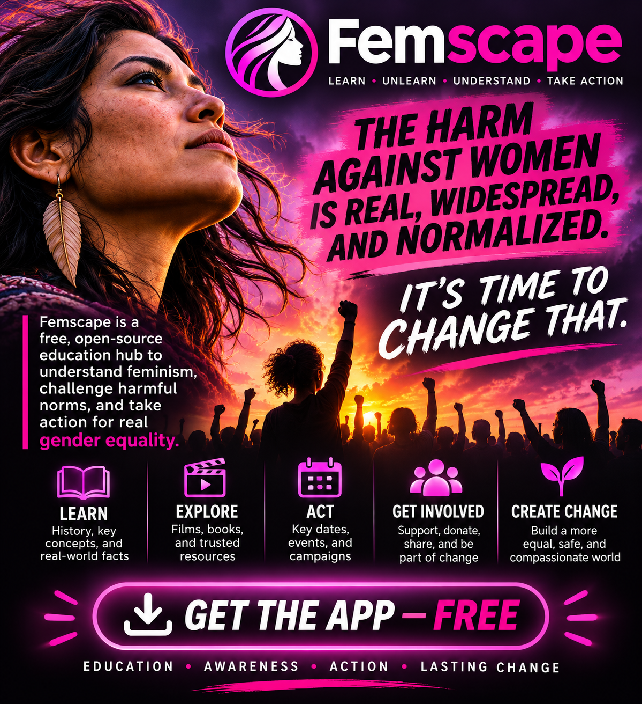

# Femscape

**Understand harm. Create change.**  
*Learn. Reflect. Act.*




Femscape is a **free, open-source, dark-mode-only educational web application** about feminism, gender inequality, the normalization of harm, and constructive social change. It is built especially to help **men understand feminism**, while welcoming anyone who wants to learn with care, listen to different perspectives, and translate understanding into action.

Femscape does not ask people to agree on every perspective. It asks them to **look seriously at the evidence, take harm seriously, question familiar assumptions, and change the behaviors they can influence.**

> You do not have to cause an injustice to have a responsibility to challenge it.

---

## Why Femscape exists

Harmful words, unequal expectations, coercive behaviors, and gender-based violence can be normalized by repetition, social pressure, institutions, and silence. Knowing that a problem exists does not automatically explain how it developed—or what an individual can do differently.

Femscape combines historical context, research, accessible explanations, practice, and specific action steps. It aims for **education without humiliation**, **accountability without dehumanization**, and meaningful respect for people affected by gender-based harm. Women are not a monolith; neither are men, and the experiences of different communities should not be flattened into a single story.

The app emphasizes both **intent and impact**, and recognizes that a sincere effort to learn must also be reflected in changed conduct.

## Explore the app

| Section | What you'll find |
| --- | --- |
| **Overview** | An urgent call to action, highlighted films, important research figures, and routes into the app. |
| **Learning path** | **12 structured lessons** on feminism, history, stereotypes, consent, care work, workplace inequality, safety, intersectionality, masculinity, allyship, and more. |
| **Practice lab** | **8 interactive everyday scenarios** for thinking through responses and their likely effects without public scoring or humiliation. |
| **Films & talks** | **20 curated talks, short films, and documentaries**, with topic filters, search, and a lightbox or original-host viewing where appropriate. |
| **When Harm Becomes Normal** | An examination of how inequality, harmful language, control, and violence can become socially accepted. |
| **History & Change** | Historical milestones, movements, and context for progress that is still unfinished. |
| **Advocacy Calendar** | Recurring gender-equality and women's-rights observances, month navigation, category filters, source links, and downloadable `.ics` entries. |
| **Resource Directory** | Curated third-party organizations, research, guidance, and educational resources searchable by topic, format/type, and keyword. |
| **Knowledge check** | A quiz with explanations and source links, intended to support understanding rather than rank people. |
| **Common questions** | Respectful answers to frequent misconceptions and concerns. |
| **Glossary** | Searchable, plain-language definitions of relevant concepts. |
| **Evidence library** | Direct links to research, public institutions, and nonprofit resources supporting the app's lessons and claims. |
| **Action plan** | A locally stored checklist organized around practical steps for today, this week, and this month. |
| **Support & safety** | U.S. domestic-violence and sexual-assault support contacts, safety considerations, and professional-resource links. |

The app also includes **share controls**, **optional developer donation links**, and a **Go Vegan sister-app link**. Donations open an external provider; payments are **not** processed within Femscape.

## A note about the homepage counter

Femscape uses a **WHO-referenced annual-prevalence figure**, stated in the app as an estimate that **316 million women aged 15 and older experienced physical or sexual violence by an intimate partner during a 12-month period** (WHO 2025). It divides that number across a year to display an illustrative equivalent of approximately **10 women per second**.

**This is not a real-time count of assaults, unique newly harmed people, or current incidents.** Annual prevalence data cannot reveal the timing or frequency of individual incidents; repeated harm is not resolved by the display. The figure resets when the app is opened. The counter is a visualization of the *scale of an estimate*, not surveillance or a live incident feed. See the app's methodology and linked WHO source before citing it.

## Download the Feminism Master Debate Sheet

Femscape includes a **printable, one-page, landscape master reference sheet** covering 15 discussion areas, from equal rights, history, and gender norms to intimate-partner violence, unpaid care, political representation, and intersectionality. It provides a quick summary and clickable source links. These references are for education, not as proof that every cited source establishes every possible claim. Recheck statistics and the linked primary publications before sharing.

- [**Download master debate sheet (PDF)**](docs/feminism_master_sheet.pdf) — printer-friendly original document.
- [**Download editable Word version (DOCX)**](docs/feminism_master_sheet.docx) — update or tailor for a live event.

The PDF and DOCX buttons are also available on the **homepage**, **Resource Directory**, and **Evidence Library** and there is a permanent PDF shortcut in the sidebar and footer. They are local downloadable assets and are cached by the PWA after successful installation. The standalone HTML and kodeWeave exports contain embedded copies to keep downloads functional away from the published site.

## Design and privacy

- **Dark mode only**: a consistent charcoal, rose, and violet interface on desktop and mobile.
- **Client-side**: the app runs in the browser; no application account or custom backend is required.
- **Progress stays local**: completed lessons, practice checklist state, and best quiz score are stored in browser `localStorage` when available. Clearing browser data removes them.
- **Portable**: a bundled `femscape-kodeWeave.json` is provided for opening the project in [kodeWeave](https://michaelsboost.com/kodeWeave/go).
- **Progressive Web App**: `manifest.json` and `sw.js` provide installability and caching support in compatible browsers. Service-worker behavior and offline availability depend on successful initial loads and external resources.
- **External links**: playing hosted media, visiting sources, and making donations can connect to third-party services subject to their own policies.
- **Accessibility-minded**: responsive layout, skip link, labeled controls, keyboard interactions, and modal behavior are included; feedback and improvements remain welcome.

## Tech stack

- HTML5, CSS, and vanilla JavaScript
- Zero-dependency Node.js (18+) build script for synchronized CSS, JS, and HTML
- A small Node.js static server (no external build packages needed)
- Alpine.js loaded from a CDN
- Native service worker and PWA manifest (no Workbox CDN dependency)
- [kodeWeave](https://michaelsboost.com/kodeWeave/go) standalone project export

### Project structure

```text
femscape/
├── index.html                 # Deployed application page
├── test.html                  # Development/test page
├── single-indexed.html        # Standalone combined HTML snapshot
├── src/
│   ├── source.html            # Application markup
│   ├── style.css              # Core styles
│   ├── bundle.css             # CSS build input
│   └── script.js              # Application logic and content data
├── dist/
│   ├── bundle.css             # Production CSS
│   └── script.js              # Production JavaScript
├── imgs/
│   ├── logo.svg               # App icon, scalable SVG
│   ├── logo-192x192.png       # PWA icon sizes (also 256, 384, 512)
│   ├── logo-wordmark.svg      # Horizontal logo treatment
│   ├── logo-wordmark.png      # Raster logo treatment
│   └── promo.png              # Promotional poster
├── docs/
│   ├── feminism_master_sheet.pdf    # Downloadable live-discussion master sheet
│   └── feminism_master_sheet.docx   # Editable master sheet
├── scripts/                  # No-dependency build and local server
├── manifest.json
├── sw.js
├── femscape-kodeWeave.json
├── package.json
├── LICENSE.md
└── README.md
```

## Run locally

**Termux:** Run `bash termux-build.sh` from the project directory. This portable wrapper calls the same no-dependency build script; it does not download npm packages or assume an Urban Forager directory.


Download this project archive or clone your published repository, then run from its root:

```bash
npm install --offline   # optional: project has zero third-party npm dependencies
npm run build
npm test
npm run serve
```

Open **http://localhost:8081**. The `serve` script uses the bundled Node.js static server on port `8081`. `npm run build` rebuilds production CSS/JavaScript, synchronizes page markup, generates the standalone snapshot and portable kodeWeave JSON, and regenerates `femscape-source-v1.3.zip` for the app’s Source code links. No npm packages need to be downloaded.

The built site can also be hosted as ordinary static files. Deploy the HTML, `dist`, `docs`, `imgs`, the manifest, the source ZIP, and the service worker together. After deployment, verify service-worker updates, routes, film embeds, external links, PWA icons, and sharing on mobile.

**Configured app URL:** `https://michaelsboost.com/femscape/` (publish or verify availability before advertising it as a live demo). The build creates `femscape-source-v1.3.zip` at the path already used by the app’s navigation.

## How content is sourced

Femscape provides linked educational summaries rather than presenting every assertion as settled fact. Source links in the bundled content include international bodies, government agencies, researchers, and support organizations. Some resources are country-specific; **U.S. legal and support guidance does not automatically apply globally**.

Please check original publications for dates, scope, definitions, methodological limits, and corrections. An illustrative scenario is a teaching example—not an empirical study, quotation, or legal ruling. Source URLs and hosted video permissions can change.

## Safety and scope

Femscape is not a substitute for **legal advice, counseling, crisis intervention, professional safeguarding, or individualized medical support**. Survivors retain the right to decide what feels safest for them. Do not pressure someone to disclose, confront an abuser, or take action on a predetermined timeline. If there is immediate danger, contact local emergency services; the app's **Support & safety** page lists additional resources.

## Companion project

**[Go Vegan](https://michaelsboost.com/govegan/)** is a sister app focused on animal use, evidence, and reducing exploitation. The projects are separate learning tools, united by care, thoughtful examination of harmful norms, and practical action.

## Contribute and support

Corrections, new research, better explanations, accessibility improvements, translations, resource maintenance, and responsible educational contributions are welcome. Prefer primary references or well-supported scholarship, label uncertainty, and avoid inventing citations or presenting contested claims as settled.

To support independent development, visit **[michaelsboost.com/donate](https://michaelsboost.com/donate)**. Sharing the app, reporting issues, or improving its source material also helps.

## License

**MIT License** — see [LICENSE.md](LICENSE.md).  
© 2026 Michael Schwartz.

---

*Promotional artwork is illustrative concept art and is not a literal screenshot of the Femscape interface.*


## Logo / brand image

The navigation uses `imgs/logo.png`, a transparent square PNG (the woman, flowing hair, and circular frame only). To replace the sidebar logo, replace that file, preserving the filename, then run `npm run build`. The CSS rules for placement and sizing live in `src/bundle.css` and `src/style.css` under `.eg-brand-symbol`.

A transparent, editable vector alternative is `imgs/logo.svg`. The generated PWA icons in `imgs/logo-192x192.png` and other sizes can be replaced separately if the installed-app icon should change. The build embeds the PNG in `single-indexed.html` and the kodeWeave project so there is no missing relative image. Bump the service worker cache name in `sw.js` after branding updates to avoid stale mobile caches.
